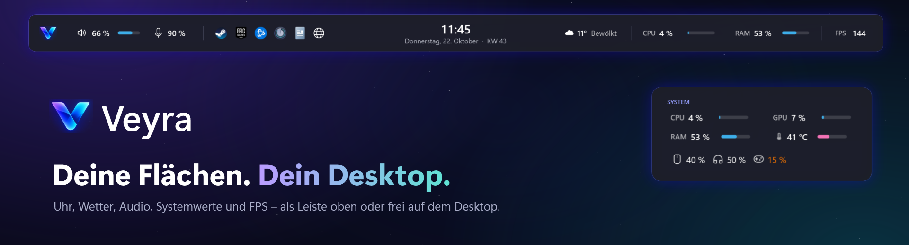
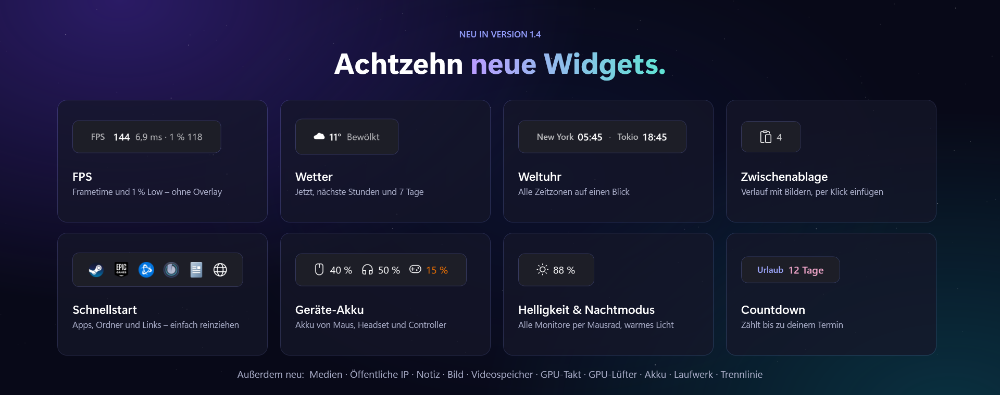
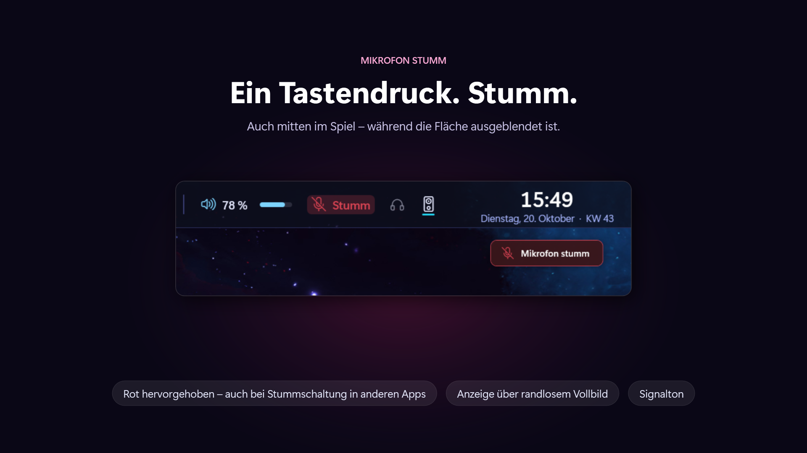
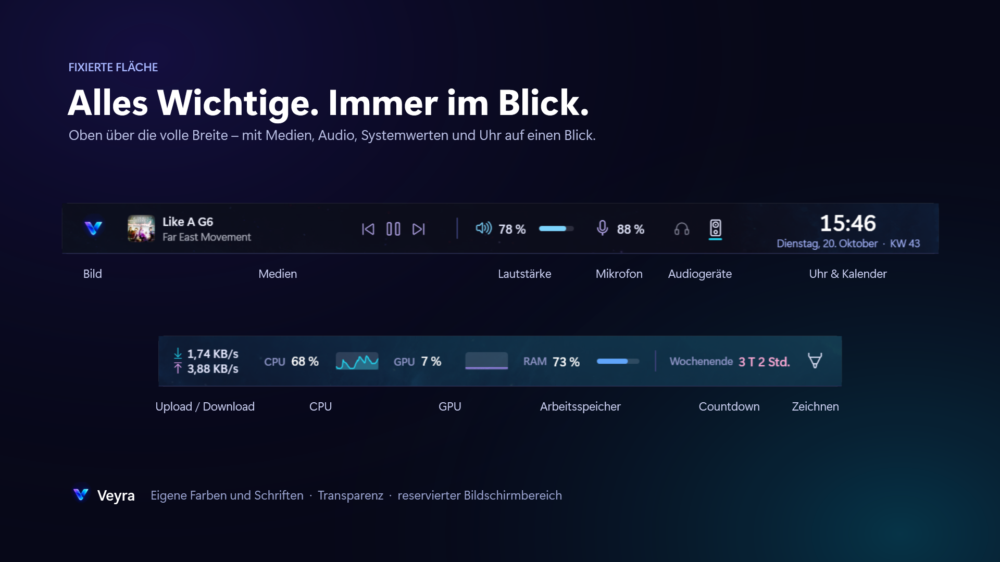
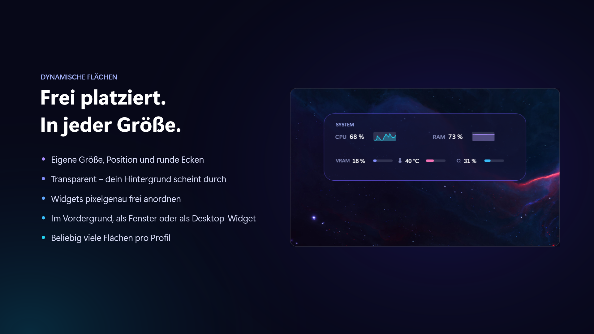
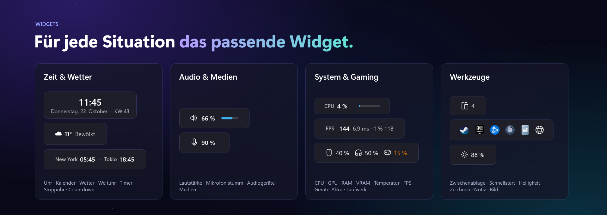
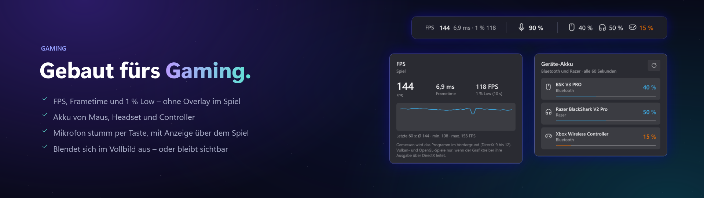
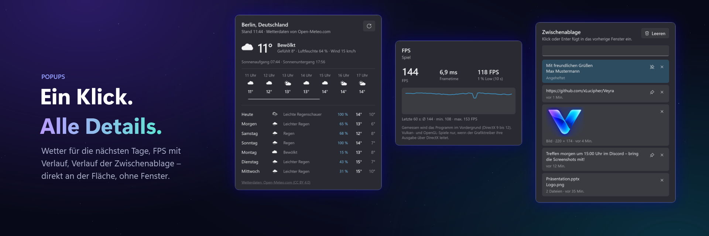

  <b>Deine Flächen. Dein Desktop.</b> 
  Uhr, Audio, Medien und Systemwerte für Windows – als Leiste am oberen Bildschirmrand oder als freie Flächen auf dem Desktop. 
  Veyra ergänzt die Windows-Taskleiste, ohne sie zu verändern.

  
  
  

  <a href="https://github.com/xLucipher/Veyra/releases/latest"><b>⬇ Veyra herunterladen</b></a>

---

## Neu in Version 1.4

Das bisher größte Update: achtzehn neue Widgets, Profile, Zeichnen auf dem Bildschirm und komplett neu aufgebaute Einstellungen. Alle Details stehen in den [Versionshinweisen](https://github.com/xLucipher/Veyra/releases/latest).

- **Achtzehn neue Widgets:** Medien, FPS, Wetter, Weltuhr, Zwischenablage, Schnellstart, Geräte-Akku, Helligkeit & Nachtmodus, öffentliche IP, Notiz, Bild, Countdown, Videospeicher, GPU-Takt, GPU-Lüfter, Akku, Laufwerk und Trennlinie.
- **Profile:** eigene Ansichten mit eigenen Flächen und Widgets, z. B. „Arbeit“ und „Gaming“. Umschalten per Tastenkürzel über eine Auswahl, die sich wie ein Spiel-Overlay über alles legt, auch im randlosen Vollbild.
- **Auf den Bildschirm zeichnen:** Stift, Textmarker, Pfeil, Formen und Radierer, direkt über allen Fenstern und Spielen. Ideal zum Zeigen, Erklären und Streamen.
- **Mikrofon stumm per Tastenkürzel:** auch mitten im Spiel, mit roter Markierung, Anzeige auf dem Bildschirm und Signalton.
- **Neu aufgebaute Einstellungen:** klar gegliedert nach Profil → Fläche → Widget, mit „Widget hinzufügen“ samt Suche und einer Pipette, die Farben direkt vom Bildschirm aufnimmt.
- **Aus Leisten werden Flächen:** Veyra kann längst mehr als eine Leiste. Jede Fläche ist ein eigenes Fenster, fixiert oben oder frei auf dem Desktop.

## Zwei Arten von Flächen

**Fixiert:** oben über die volle Bildschirmbreite angedockt, auf Wunsch mit reserviertem Bildschirmbereich, damit Fenster nicht darunter rutschen.

**Dynamisch:** frei beweglich, in jeder Größe, mit runden Ecken und durchscheinendem Hintergrund – im Vordergrund, als normales Fenster oder als Widget auf dem Desktop.

## Funktionen

### Zeit
- **Digitaluhr** exakt in der Bildschirmmitte, wahlweise mit Datum und Kalenderwoche. Ein Klick öffnet den Monatskalender. Mehrere Uhren lassen sich unabhängig voneinander gestalten (Format, Schrift, Farben, Sprache).
- **Timer:** beliebig viele Timer mit eigener Dauer, direkt im Popup anlegen, starten, pausieren und zurücksetzen. Nach Ablauf gibt es eine Windows-Benachrichtigung und auf Wunsch einen Signalton, auch wenn die Fläche gerade bei Vollbild ausgeblendet ist.
- **Stoppuhr** mit Rundenzeiten; schnellste und langsamste Runde sind markiert.
- **Countdown** bis zu einem Datum, z. B. „Urlaub: 12 Tage“. Auf Wunsch täglich, wöchentlich, monatlich oder jährlich wiederholt.
- **Weltuhr:** Uhrzeit in anderen Zeitzonen, z. B. „New York 08:31 · Tokio 21:31“. Ein Klick zeigt alle Orte mit Datum und Zeitunterschied.
- **Wetter:** Temperatur und Wetterlage für deinen Ort, im Popup mit den nächsten Stunden und 7 Tagen. Ort, Einheiten und Anzeige sind einstellbar; die Daten kommen ohne Konto von Open-Meteo.

### Audio & Medien
- **Audio-Schnellwechsel:** Buttons für Wiedergabegeräte und Mikrofone. Ein Klick macht das Gerät zum Standard, ein Tastenkürzel wechselt reihum – auch im Spiel.
- **Lautstärke:** Systemlautstärke oder Mikrofonpegel als Symbol, Prozentwert und Balken. Mausrad, Regler, Stummschalten und die Lautstärke jeder App einzeln, wie im Windows-Lautstärkemixer.
- **Mikrofon stumm** per Tastenkürzel, rot hervorgehoben, mit Anzeige oben auf dem Bildschirm und Signalton.
- **Medien:** Titel, Interpret und Cover samt Zurück, Wiedergabe/Pause und Weiter – für alles, was Windows als Wiedergabe kennt (Spotify, Browser, Medienwiedergabe …). Ein Klick zeigt alle laufenden Player zur Auswahl.

### System & Netzwerk
- **Systemauslastung:** CPU, GPU, Arbeitsspeicher, GPU-Temperatur, Videospeicher, GPU-Takt und GPU-Lüfter – als Zahl, Balken oder Verlauf der letzten Minute, mit Warnfarben bei hoher Last. Alles direkt aus Windows gelesen, ohne Zusatzsoftware und ohne Adminrechte.
- **FPS:** Bilder pro Sekunde des Spiels im Vordergrund, auf Wunsch mit Frametime und 1 % Low, dazu ein Verlauf der letzten Minute. Gemessen direkt über Windows (DirectX 9 bis 12), ohne Overlay und ohne Adminrechte: Dafür muss dein Konto einmalig in die Windows-Gruppe „Leistungsprotokollbenutzer“ – per Häkchen im Installer oder per Klick im Widget.
- **Akku und Laufwerke:** Ladestand mit Restlaufzeit; belegter oder freier Speicher eines Laufwerks.
- **Geräte-Akku:** Ladestand von Maus, Tastatur, Headset und Controller – mit Warnfarben und Benachrichtigung bei wenig Akku.
- **Helligkeit & Nachtmodus:** Helligkeit aller Monitore per Mausrad oder Regler (DDC/CI), dazu ein Nachtmodus mit warmem Licht – von Hand, per Tastenkürzel oder nach Zeitplan.
- **Netzwerk:** aktuelle Verbindung (LAN/WLAN) mit Netzwerkname und Signalstärke. Ein Klick zeigt IP-Adressen, Gateway, DNS, Adapter und Geschwindigkeit. Ab Windows 11 24H2 gibt Windows WLAN-Name und Signalstärke nur heraus, wenn Desktop-Apps auf den Standort zugreifen dürfen.
- **Upload / Download** in Echtzeit, getrennt oder zusammen, optional mit Verlaufsgrafik.
- **Öffentliche IP:** deine öffentliche IPv4- und IPv6-Adresse, auf Wunsch verborgen (z. B. beim Streamen). Nach jeder Netzwerkänderung, etwa einem VPN, sofort aktuell.

### Gestaltung & Werkzeuge
- **Bild:** ein beliebiges Bild aus einer Datei, immer griffbereit auf der Fläche – mit Größe, runden Ecken, Deckkraft und optionaler Klick-Aktion.
- **Notiz:** freier Text, der sich per Klick direkt auf der Fläche bearbeiten lässt.
- **Trennlinie:** Linien, Punkte oder Abstände zum Gliedern.
- **Zeichnen:** direkt auf den Bildschirm malen, über allen Fenstern und randlosen Vollbildspielen. Das Gezeichnete bleibt stehen, bis du es löschst.
- **Zwischenablage:** Verlauf der zuletzt kopierten Texte, Bilder und Dateien – durchsuchen, anheften und per Klick oder Tastenkürzel direkt einfügen. Was Passwortmanager als vertraulich markieren, bleibt draußen.
- **Schnellstart:** Programme, Ordner, Dateien und Webadressen als Symbole. Einfach auf das Widget ziehen, um sie hinzuzufügen.

### Flächen, Profile & Bedienung
- **Beliebig viele Flächen**, jede mit eigener Darstellung, Ebene, Monitor und eigenen Widgets.
- **Profile** für verschiedene Situationen, umschaltbar per Tastenkürzel (Standard *Strg + Alt + P*), Rechtsklick oder in den Einstellungen.
- **Widgets frei anordnen** per Drag & Drop. Mit der freien Platzierung liegen Widgets pixelgenau, wo du sie haben willst. *Position sperren* schützt vor versehentlichem Verschieben – für die ganze Fläche oder per Rechtsklick nur für ein einzelnes Widget.
- **Anpassbar:** Farben samt Farbkreis und Pipette, Transparenz, Schriften, Höhe, Formate und Monitor. Änderungen wirken sofort.
- **Gaming-freundlich:** praktisch keine CPU-Last im Leerlauf, keine GPU-Nutzung, kein Fokusdiebstahl und kein Eintrag in Alt+Tab. Bei Vollbild blendet sich Veyra automatisch aus – oder bleibt auf Wunsch sichtbar, und das Spiel rückt darunter.
- **Automatische Updates** über GitHub, mit Rückfrage. Vor jedem Speichern sichert Veyra deine Einstellungen.

## Installation

1. Unter [**Releases**](https://github.com/xLucipher/Veyra/releases/latest) die Datei `Veyra-Setup-<Version>.exe` herunterladen und starten.
2. Dem Assistenten folgen. Fehlt die benötigte **Microsoft .NET 10 Desktop Runtime**, bietet der Installer an, sie direkt von Microsoft zu installieren. Das passiert nur mit deiner Zustimmung.
3. Fertig. Veyra startet auf Wunsch direkt und bei jeder Anmeldung.

Es sind keine Administratorrechte nötig. Veyra erscheint wie jedes andere Programm im Startmenü und unter *Programme und Features*.

**Voraussetzungen:** Windows 10 (1809) oder Windows 11, 64 Bit.

## Bedienung

| Aktion | Wirkung |
|---|---|
| Rechtsklick auf die Fläche | *Einstellungen*, *Position sperren*, Widget unter der Maus sperren, Profil wechseln, *Profilauswahl*, *Fläche neu laden*, *Beenden* |
| Strg + Alt + P (einstellbar) | Profilauswahl öffnen/schließen: Pfeiltasten und Enter oder 1–9 wechseln, Esc schließt |
| Klick auf Uhrzeit/Datum | Monatskalender öffnen (an freier Stelle ziehen = verschieben) |
| Klick auf einen Audio-Button | Gerät als Standard verwenden |
| Klick auf Netzwerk, Lautstärke, Timer, Stoppuhr, Medien, Wetter, Weltuhr, Zwischenablage, Geräte-Akku, IP oder Helligkeit | Popup mit Details bzw. Bedienung (Esc oder Klick daneben schließt) |
| Klick auf den Stift (Zeichnen) | Zeichnen starten; *Fertig* oder Esc beendet es, das Gezeichnete bleibt stehen |
| Klick auf eine Notiz | Notiz bearbeiten; gespeichert wird beim Schließen |
| Klick auf ein Bild | öffnet die eingestellte Webadresse, Datei oder das Programm (falls festgelegt) |
| Mausrad über dem Lautstärke-Widget | Lautstärke ändern (Schrittweite einstellbar) |
| Mausrad über dem Helligkeits-Widget | Helligkeit aller Monitore ändern |
| Dateien, Ordner oder Links auf den Schnellstart ziehen | als Eintrag hinzufügen |
| Rechtsklick auf das Lautstärke-Widget | stumm schalten bzw. Stummschaltung aufheben |
| Klick auf einen abgelaufenen Timer | Alarm beenden |
| Leertaste / R / Entf im Stoppuhr-Popup | Start/Pause / Runde / Zurücksetzen |
| Tastenkürzel der Widgets | z. B. lauter/leiser, stumm, Timer und Stoppuhr steuern, Wiedergabe/Pause, Zeichnen – global, auch im Spiel; Kombination oder einzelne Taste (festlegen unter *Einstellungen → Fläche → Widgets*) |
| Widget ziehen | Position auf der Fläche ändern (nicht bei gesperrter Position) |
| Dynamische Fläche ziehen / an den Rändern ziehen | verschieben / Größe ändern |
| Strg + Ziehen (freie Platzierung) | dynamische Fläche verschieben, auch über einem Widget |
| Veyra im Startmenü erneut starten | öffnet die Einstellungen |

## Updates

Veyra sucht kurz nach dem Start und danach alle paar Stunden nach einer neuen Version. Während eines Vollbildspiels fragt Veyra nie. Gibt es ein Update, kannst du wählen:

- **Ja:** installieren, Veyra startet danach neu.
- **Später:** in 24 Stunden erneut fragen.
- **Nein:** diese Version überspringen.

Die automatische Prüfung lässt sich unter *Einstellungen → System & Updates* abschalten.

## Deinstallation

Über *Einstellungen → Apps → Installierte Apps* oder *Systemsteuerung → Programme und Features*. Veyra wird beendet, der Autostart entfernt, und du kannst wählen, ob deine Einstellungen erhalten bleiben. Sicherungen der letzten 10 Fassungen liegen in `%AppData%\Veyra\backups`.

---

Technische Details zu Build, Aufbau und Releases: [docs/ENTWICKLUNG.md](docs/ENTWICKLUNG.md)
